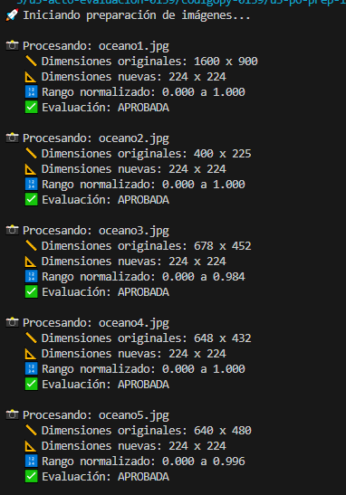
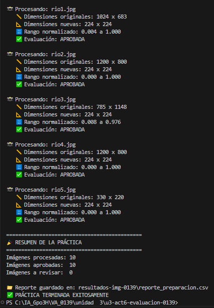
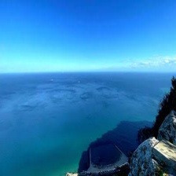
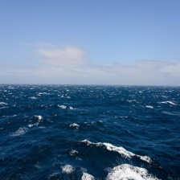
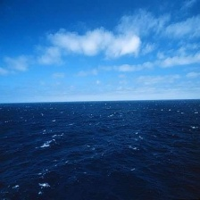
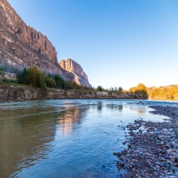
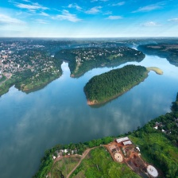
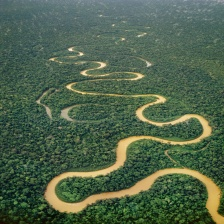
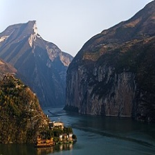
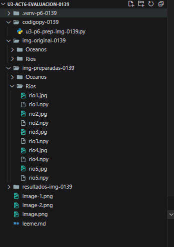

# 🚀 Práctica Guiada: Preparación y Evaluación de Imágenes para Visión Artificial

> **Nivel:** Básico – Principiante (Desde cero)  
> **Duración:** 2 horas  
> **Asignatura:** Soluciona problemas de Visión Artificial  
> **Especialidad:** Inteligencia Artificial  
> **Semestre:** 3º de Preparatoria  
> **Herramientas:** Python, Visual Studio Code, OpenCV y NumPy.
## Alexander Salazar 0139
# resultado
 
# oceanos
 

# Rios

# Estructura de Archivos
